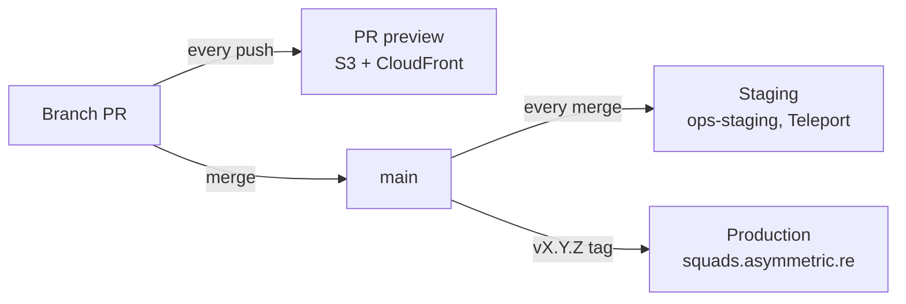

# Deploying the verifier

How a change gets from a branch to squads.asymmetric.re. This is the runbook; for how the infrastructure is wired
(ArgoCD, certificates, one-time setup) see [`deploy/README.md`](../deploy/README.md).



| Stage      | Trigger             | Workflow                                                        | Where                                                            | Who can see it   |
|------------|---------------------|-----------------------------------------------------------------|------------------------------------------------------------------|------------------|
| Preview    | Push to a PR        | [`preview.yml`](../.github/workflows/preview.yml)               | URL commented on the PR                                          | Anyone with link |
| Staging    | Merge to `main`     | [`publish-main.yml`](../.github/workflows/publish-main.yml)     | <https://squads-verifier-staging.asymmetricresearch.teleport.sh> | All employees    |
| Production | Push a `vX.Y.Z` tag | [`publish-semver.yml`](../.github/workflows/publish-semver.yml) | <https://squads.asymmetric.re>                                   | Public           |

All three talk to Solana mainnet. Approving or rejecting a proposal on a preview or on staging signs a real
transaction.

## 1. PR previews

Every push to a branch PR builds the site and uploads it to a fresh `pr-<num>/<shortsha>/` prefix. The PR gets a
comment with the URL, updated on each push. Previews live for 30 days from upload. PRs from forks get no preview.

A preview is the static build only: the nginx security headers are not exercised. Check those on staging, or locally:

```bash
docker build -t squads-verifier . && docker run --rm -p 8080:8080 squads-verifier
```

## 2. Staging

Every merge to `main` builds an image tagged `main-<sha>`, and `argocd-image-updater` rolls staging to it within a few
minutes. Before a release, check the changed views on staging, with a wallet connected if signing changed.

```bash
gh run list -R asymmetric-research/squads.asymmetric.re -w "Publish Main Image" -L 3
```

## 3. Production releases

Production updates only when a `vX.Y.Z` tag is pushed. The publish job runs in the `production` environment, which
needs approval from a second reviewer (the tag pusher cannot approve their own release), and fails unless the tagged
commit is on `main`.

What is about to ship:

```bash
git fetch --tags origin
git log --oneline "$(git describe --tags --abbrev=0 origin/main)..origin/main"
```

Cut the release from the `main` commit you checked on staging:

```bash
git tag -a v0.1.1 origin/main -m "release v0.1.1"
git push origin v0.1.1
```

Then ask another reviewer to approve the run (Actions → **Publish Semver Image** → **Review deployments**). Once the new
pods are up, load https://squads.asymmetric.re and check the response headers:

```bash
curl -sI https://squads.asymmetric.re | grep -i content-security-policy
```

## 4. Rolling back

Production runs the most recently built `vX.Y.Z` image (image-updater's `newest-build` strategy), so pushing an older
tag again does nothing.

- **Preferred:** revert on `main` with a PR, then cut a new patch release.
- **Emergency:** re-run **Publish Semver Image** on the last good tag (needs a second reviewer too), then follow up with
  a revert on `main`.

  ```bash
  gh workflow run publish-semver.yml -R asymmetric-research/squads.asymmetric.re --ref v0.1.0
  ```

## What deploys how

| Change                                         | Reaches staging                  | Reaches production               |
|------------------------------------------------|----------------------------------|----------------------------------|
| Site code, styles, assets                      | On merge to `main`               | On the next release tag          |
| nginx headers / CSP, `RPC_URL` variable        | On merge to `main`               | On the next release tag          |
| Production manifests (`deploy/*.yaml`)         | No                               | On merge to `main` (ArgoCD sync) |
| Staging manifests (`deploy/staging/`)          | On merge to `main` (ArgoCD sync) | No                               |
| ArgoCD Application or image-updater settings   | Edit in `config-management`      | Edit in `config-management`      |

Production manifest changes go live on merge, without a release tag. Review them as carefully as a release.
